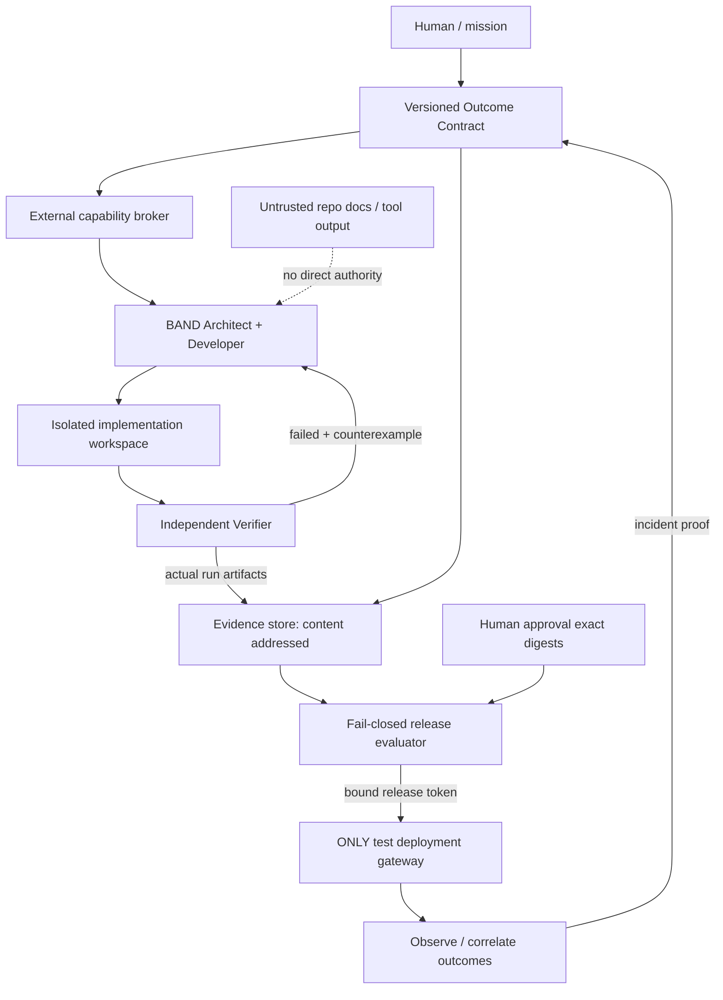

# Architecture V0 — intent, evidence and release without conflating trust

**DESIGN ONLY until official kickoff.** Role prompts are not sandbox boundaries. A token from the proof-of-concept must not be treated as production authorization.



## Separation of assertions

- **Identity**: an agent is known; it is not necessarily authorized.
- **Authority**: a policy says which action it may attempt; no authority can be acquired from a chat message.
- **Execution**: a tool actually ran in a particular environment, ideally attested by an executor isolated from the coding agent.
- **Verification**: a **precisely scoped** property passed a check against a particular artifact at a time, with genuine stdout/stderr, trace and test code hashes.
- **Release permission**: a separately authorized party accepts the scoped evidence for the exact artifact and policy/spec version. It does not assert correctness outside tested properties.
- **Production outcome**: later measured events, never inferred from the mere absence of test failures.

## Minimal V1 dataflow

```
OutcomeContract V0 (immutable revision, requirements digest)
  -> task DAG / role-scoped instructions over BAND
  -> isolated worktree and deterministic build
  -> verifier-authored fixed acceptance suite / seeded challenger suite
  -> attempted falsification and counterexample with commands + traces
  -> evidence manifest with paths and SHA-256 of execution artifacts
  -> release evaluation (deny if missing/failed/stale/cross-project)
  -> Lucas approves exact artifact+evidence+contract digests
  -> ephemeral release token verified at the only deployment gateway
  -> test/staging deploy only; post-deploy smoke check
```

## Entities: proposed schemas

**Mission** `mission_id`, `version`, `intended_user`, `outcome`, `invariants[]`, `explicit_non_goals[]`, `authorized_resource_scopes[]`, `budget`, `escalation`, `acceptance_required[]`, `spec_digest`.

**Evidence** `mission_id`, `claim_id`, `subject_artifact_sha256`, `spec_digest`, `test_definition_sha256`, `output_trace_sha256`, `environment`, `issuer`, `issuer_signature`, `result=pass|fail|not_run|unknown`, `timestamp`, `verification_limits`.

**Release request** `commit_oid`, `tree_oid`, `artifact_sha256`, `container_image_digest_when_applicable`, `mission_spec_digest`, `policy_digest`, `evidence_root`, `human_approval_signature`, `expires_at`.

**Release token** gateway-signed, references release request digest; consumed once where practical; gateway independently resolves the deployed artifact digest and rejects mismatch/replay/stale/unsigned.

## Refuse misleading shortcuts

- A verifier writing 'PASS' into chat is **not** a verified result.
- Hashing test logs shows *integrity of those bytes*, not that the run happened or the tests were valid.
- A signed output from a verifier that shares builder credentials does **not** establish independence.
- HMAC with key available in the same process as untrusted agent code is a **research spike only**.
- CI status without binding to tested commit+artifact is stale after any mutation.
- A release token without an enforced deployment gateway is only an advisory badge.

## Next integration choices (conditional)

**BAND:** reuse its existing communication and run record; do not make a replacement agent chat app.\
**Amazon:** self-hosted MCP Streamable HTTP ≥2025-11-25 or a disclosed genuine Alexa+ simulation; AgentCore only after documenting real gateway execution+policy and bypass prevention.\
**Nebius:** replace *relevant inference/exec tasks* with live supported NVIDIA open-source model on Token Factory; record model IDs and real Sandbox run IDs/cost; publish full OSS runnable mirror at final submission.
