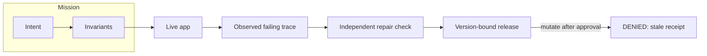

# Experience and authentic demo storyboard

The user's primary object is the **application being created**, not a collection of agent avatars. A viewer must understand the real-world consequence of the defect within ~15 seconds. Every graph/number must be derived from a genuine stored run; synthetic demo input is clearly labelled.

## Four views, one coherent object

1. **Mission canvas:** outcome, key invariants and risk surface in plain English, with a drill-down to machine-readable contract and resource permissions. User can ask: "Which property would block release?"
2. **Living software twin:** functional features as connected components with *evidence coverage*, not a mathematically dubious composite 'confidence percentage'. Selecting a consequential feature (illustrative example: `Transfer funds`; the real feature depends on the official track domain, UNKNOWN until the challenge pack) expands requirements, implementation, tests, failure traces and known unknowns. Distinguish `passed`/`failed`/`unknown`/`not run` in color AND text.
3. **Counterexample theater:** actual minimal failing event sequence (request A, retry A, concurrent worker event, observed wrong state) with replay button wired to true sandbox run. Show test command, seed, runtime version and diff. Provide plain-English 'what broke' and 'how to reproduce' cards.
4. **Release decision:** exact artifact digest, fixed test results, failed/unattempted properties, human signature action. After the user authorizes a tested artifact, a trivial one-line change invalidates it and visibly blocks staging deploy. This is the final memorable reveal.

## The on-camera live failure

- Begin with the app usable and three BAND seats visible.
- Trigger a controlled, repeatable *actual* bug from the domain revealed in the challenge pack; no claim that the agent discovered a bug we pre-injected unless it truly did.
- Independent verifier produces executed failing trace, bounded claim, and a repair request.
- Developer implements correction in isolated branch, verifier reruns (including unchanged challenger cases).
- Human approves exact tested artifact, staging deploy succeeds through gate.
- **Surprise**: change one byte after approval; gateway refuses, evidence is stale. Explain what was proven, what was NOT proven.

## Three distinct judge videos (<3 minutes where sponsor requires)

**BAND:** 0–25 sec consequential app and challenge, 25–105 genuine BAND factory/run + verifier defect/repair, 105–150 artifact-bound gate, 150–175 reproducibility and limitations. Do not omit official four stages.

**Amazon:** Human in a genuine hands-busy incident/on-call context asks Alexa+-style agent for status, receives concise spoken response plus interactive evidence card, drills into counterexample and invokes *safe, appropriately authorized* approval or escalation. No 'we made a voice control for a dashboard' pitch. Use an actual self-hosted MCP server **or** accurately labelled allowed simulator; AWS integration only if it materially enforces policy.

**Nebius:** Show NVIDIA open-model call through Token Factory and actual Sandbox write/run/test on a real branch; compare a small baseline task using predeclared metrics; show visible product, not an API cURL screenshot. Give actual model IDs, failure cases and total cost.

## Design quality gates

- Desktop 1440 and laptop 1280 plus 390 mobile quick view; keyboard and meaningful 44px touch targets.
- Color-blind accessible status labels and contrast; no 'green safe' when evidence is incomplete.
- Live app + factory can each be demonstrated offline/local where practical; screenshots match exact tag.
- No generated fake charts, fake user activity, fake security badges or unlabeled simulated traces.
