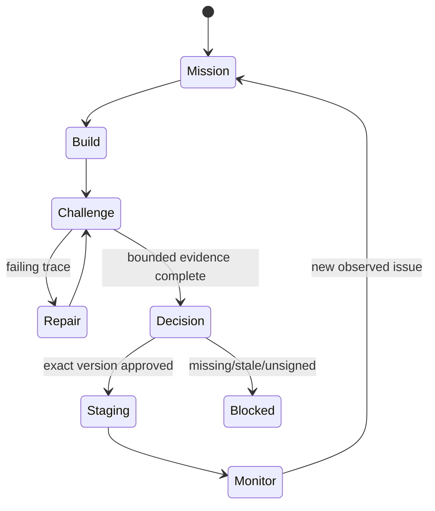

# Minimal product experience specification

**Domain caveat:** the official track domain (Pocketful/Tablekeeper) is UNKNOWN until the challenge pack (ledger DF-02). "Wallet" below is an illustrative placeholder, not an assumption that Pocketful is a financial application.

**First-time story:** Tech lead asks "Can this build ship?" (e.g. an illustrative wallet build) → one-screen answer includes artifact ID and blockers; click opens actual deterministic counterexample; inspect diff and re-run it; approve an exact version after all required scoped claims pass; demonstrate a post-approval mutation blocked.

## Interaction map

## Four public-facing screens

- **Mission**: app preview + accepted outcome + the three consequential properties; inspect full spec and audit trail in a drawer.
- **Build/Challenge**: one active step at a time with true BAND role identity and artifact links; simulated progress is visibly labelled as simulated.
- **Evidence**: clickable claims, failed trace timeline, executed tests + source hashes; don't hide UNKNOWN/NOT_RUN behind a green average.
- **Release**: immutable subject digest, explicit human approval and external gate status. Demo's final mutation immediately updates badge to `BLOCKED — tested artifact changed`.

## Accessibility and credibility

Responsive 1440/1280/390 layouts; keyboard first, high contrast, color+text statuses, affordances clearly distinguish inspect from approve, sensitive actions require explicit confirmation. Every graph reads directly from signed/recorded artifacts and links to reproduction command. No fake visual countdown or unattributed benchmarks.

## Alexa+ research task (conditional)

Observe a real on-call person doing a short, hands-busy 3-step incident triage: (1) get concise voice situation, (2) view one real counterexample on another screen, (3) open/escalate correctly authorized action. Compare against ordinary laptop dashboard task time/effort. If not substantively useful by Oct 8, change the experience; don't merely add voice to the existing release page.
